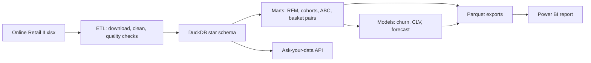
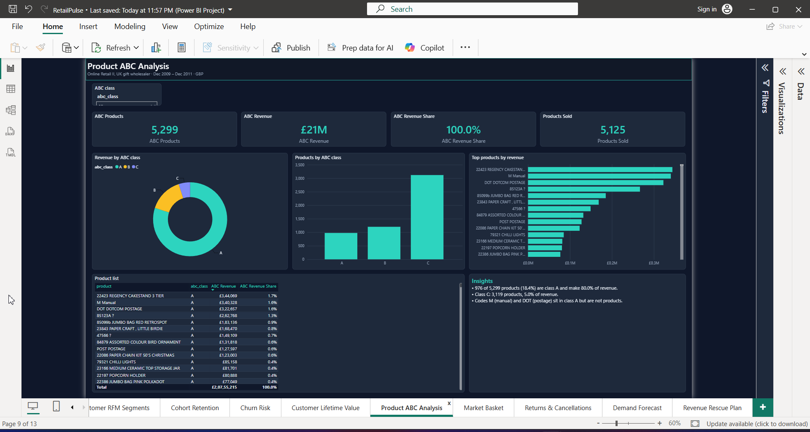

# RetailPulse

Churn, customer lifetime value and demand forecasting for a UK online gift wholesaler, built on the
public [UCI Online Retail II](https://archive.ics.uci.edu/dataset/502/online+retail+ii) dataset
(1,055,238 transaction lines, Dec 2009 - Dec 2011).


## Business problem

The company sells to about 5,900 known customers, mostly small retailers. Revenue is flat year on
year, it depends heavily on a short pre-Christmas peak, and a large part of the customer base has
gone quiet. The business needs to know:

- which customers are about to stop buying, and how much revenue sits with them
- what those customers are likely to be worth over the next six months
- how much stock to plan for the top products in the peak weeks
- which products drive revenue and which ones sell together

## Solution

- A DuckDB star schema and analysis marts built from the raw Excel file
- RFM segmentation, a churn classifier, a CLV model and a weekly demand forecast, tracked in mlflow
- A small ask-your-data API: a question in plain English becomes read-only SQL over the warehouse
- A 13-page Power BI report that puts the numbers and the model scores in front of the business

## Approach



1. **ETL** (`src/retailpulse/etl`): downloads the workbook, merges both yearly sheets, drops exact
   duplicates and rows without a stock code, flags cancellations (`C` invoices) and runs quality checks.
2. **Warehouse** (`sql/schema.sql`, `sql/marts.sql`): `fact_sales`, `fact_returns`, `dim_customer`,
   `dim_product`, `dim_date`, `dim_country`, plus marts for RFM, monthly KPIs, cohorts, ABC and basket pairs.
3. **Models** (`src/retailpulse/models`):
   - churn: no purchase in the 90 days after a cutoff; logistic regression and gradient boosting,
     trained on a cutoff 180 days before the last date and tested on a cutoff 90 days before it
   - CLV: BG/NBD + Gamma-Gamma (lifetimes), 180-day horizon, scored against the real next 180 days
   - forecast: LightGBM on weekly units for the top 50 products, lag and rolling features, last
     8 weeks held out, compared to a seasonal naive baseline (same week last year)
4. **Ask-your-data API** (`src/retailpulse/ask`): FastAPI `POST /ask`. SQL is checked by a guardrail
   (single `SELECT`, allowed tables only, forced `LIMIT`) before it runs. Without a model endpoint it
   answers from built-in SQL templates.
5. **Power BI** (`dashboard/`): the project files are written by `tools/generate_pbip.py`, so the model
   and the report stay in sync with the data.

## Key insights

All figures are GBP, Dec 2009 - 9 Dec 2011, from `data/powerbi` via DuckDB (`tools/compute_insights.py`).

| Area | Finding |
|---|---|
| Size | £20,755,215 revenue, 45,336 orders, 5,881 known customers, AOV £458 |
| Growth | Like-for-like (1 Jan - 9 Dec) revenue was £9,750,358 in 2010 and £9,798,552 in 2011: **+0.5%** |
| Seasonality | Sep-Nov made 34.6% of 2010 revenue; peak week starts 2010-12-06 (£582,070); best month 2011-11 (£1,503,867) |
| Geography | UK is 85.1% of revenue; top export markets are EIRE (£664,050), Netherlands (£554,231), Germany (£430,704) |
| Customers | Champions are 22.2% of customers (1,304) and bring 68.4% of customer revenue |
| Retention | Average month-1 retention across 24 cohorts is 21.2% |
| Churn risk | 3,241 of 5,283 scored customers (61.3%) have churn probability >= 0.7; they account for £3,496,501 of past revenue |
| Value at risk | Among them: At Risk segment 703 customers / £1,258,615, Regular 1,146 / £744,731, Champions 199 / £606,259 |
| CLV | Average predicted 6-month CLV £640; the top 10% of customers hold 68.8% of predicted CLV |
| Products | 976 of 5,299 products (18.4%) are class A and make 80.0% of revenue; 3,119 class C products make 5.0% |
| Basket | Top pair: Jumbo Bag Pink With White Spots + Red Retrospot Jumbo Bag (1,426 orders) |
| Returns | 8,292 cancelled invoices worth £1,523,415, a 7.34% return rate by revenue |

## Model results

Holdout results from `reports/metrics.json`.

| Model | Metric | Result | Baseline / note |
|---|---|---|---|
| Churn, logistic regression | ROC AUC | 0.791 | |
| Churn, logistic regression | PR AUC | 0.816 | 56.6% of scored customers churned |
| Churn, logistic regression | Precision in top 10% | 0.920 | vs 0.566 base rate |
| Churn, gradient boosting | ROC AUC / PR AUC | 0.786 / 0.804 | |
| Churn, gradient boosting | Precision in top 10% | 0.890 | |
| CLV (BG/NBD + Gamma-Gamma) | MAE | £620 | RMSE £3,850, driven by a few very large accounts |
| Weekly demand, LightGBM | WAPE | 0.715 | seasonal naive 0.996 |
| Weekly demand, LightGBM | MAPE | 2.48 | seasonal naive 6.79 |

Honest reading:

- The churn model ranks customers well enough to target a win-back list; logistic regression is
  slightly better than boosting and easier to explain.
- CLV error is dominated by the heavy tail; it is useful for ranking, less so for exact amounts.
- The forecast beats the baseline but a WAPE of 0.71 is still large. MAPE is inflated by low-volume
  weeks. Treat it as a planning aid, not a replenishment system.
- Revenue growth is only +0.5% like-for-like. The +89% YoY shown on the unfiltered card comes from
  2009 having only December in the data.

## Power BI dashboard

13 pages: Executive Summary, Revenue Trends, Seasonality & Peak Weeks, Country Performance,
Customer RFM Segments, Cohort Retention, Churn Risk, Customer Lifetime Value, Product ABC Analysis,
Market Basket, Returns & Cancellations, Demand Forecast, Revenue Rescue Plan. Each page has slicers,
KPI cards, three or four visuals and an insight box with numbers from the data.

- `dashboard/RetailPulse.pbix`: open in Power BI Desktop, data included
- `dashboard/RetailPulse.pbip`: the same report as a Power BI project (TMDL model + PBIR report as text)
- Walkthrough video: [screenshots/retailpulse-powerbi-walkthrough.mp4](screenshots/retailpulse-powerbi-walkthrough.mp4)
- All page screenshots: `screenshots/powerbi/`

| Churn Risk | Revenue Rescue Plan |
|---|---|
|  |  |
| **Cohort Retention** | **Product ABC Analysis** |
|  |  |

## Business recommendations

1. **Win-back campaign for high-risk customers.** Start with the 703 high-risk At Risk customers
   (£1,258,615 past revenue), then the 199 high-risk Champions (£606,259). The model's top 10% list is
   92% precise, so outreach effort goes to customers who really are leaving.
2. **Plan stock for the autumn peak.** Sep-Nov is about a third of the year's revenue and the peak
   week falls in early December. Lock in class A stock (976 products, 80% of revenue) before September,
   and use the forecast as a starting point with a safety margin given its error.
3. **Bundle products that already sell together.** The top pairs (jumbo bags, hanging heart
   T-light holders) appear together on 1,200-1,400 orders each; offer them as bundles or
   "frequently bought together" suggestions.
4. **Grow exports.** Outside the UK the business makes £3,099,836; EIRE, Netherlands and Germany
   are already sizeable and are the natural first markets for account management.
5. **Look into cancellations.** £1,523,415 was cancelled. The largest single line is the manual
   adjustment code, so cleaner use of adjustment codes would make return analysis more reliable.
6. **Trim the long tail.** 3,119 class C products bring 5% of revenue; review them for range cuts.

## Tech stack

Python 3.13, DuckDB, pandas, scikit-learn, LightGBM, lifetimes, mlflow, FastAPI, pytest, ruff,
Power BI Desktop (PBIP / TMDL / PBIR).

## Project structure

```
src/retailpulse/
  etl/         download, clean, quality checks
  warehouse/   build the DuckDB warehouse and parquet exports
  models/      rfm, churn, clv, forecast
  ask/         ask-your-data API (FastAPI, SQL guardrails, templates)
sql/           star schema and marts
tools/         insight numbers and Power BI project scripts
dashboard/     RetailPulse.pbix and RetailPulse.pbip
reports/       insights.md
screenshots/   dashboard screenshots and walkthrough video
tests/         pytest
```

## How to run

```bash
python -m venv .venv
.\.venv\Scripts\python -m pip install -e ".[dev]"

.\.venv\Scripts\python -m retailpulse.etl run          # data/raw, data/clean
.\.venv\Scripts\python -m retailpulse.warehouse build  # warehouse/retailpulse.duckdb, data/powerbi/*.parquet
.\.venv\Scripts\python -m retailpulse.models run       # reports/metrics.json, model scores, mlruns.db

.\.venv\Scripts\python tools\compute_insights.py       # reports/insights.md
.\.venv\Scripts\python tools\generate_pbip.py          # dashboard/RetailPulse.pbip
.\.venv\Scripts\python tools\check_pbip.py

.\.venv\Scripts\python -m retailpulse.ask serve --host 127.0.0.1 --port 8000
```

The ask API can use any OpenAI-compatible endpoint through `LLM_BASE_URL`, `LLM_API_KEY` and
`LLM_MODEL`. Without them it answers from templates and says so in the response.

Data files are not committed. After running the steps above, open the `.pbip` in Power BI Desktop
and click Refresh; the `DataFolder` parameter points at this repo's `data\powerbi`.

Tests and lint:

```bash
.\.venv\Scripts\python -m pytest -q
.\.venv\Scripts\python -m ruff check .
```

## Limitations and next steps

- Two years of data, so the forecast sees only one previous peak season and the YoY view is thin.
- About 23% of sales lines have no customer id; they count in revenue but not in customer models.
- The churn label is fixed at 90 days; wholesale customers with long buying cycles may be flagged too early.
- `dim_product` has several descriptions per stock code; the Power BI model keeps one per code.
- Next: add price and promotion features to the forecast, calibrate churn probabilities, test the
  win-back list against a holdout group, and schedule the pipeline.
