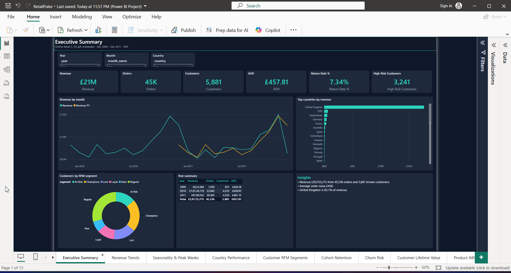
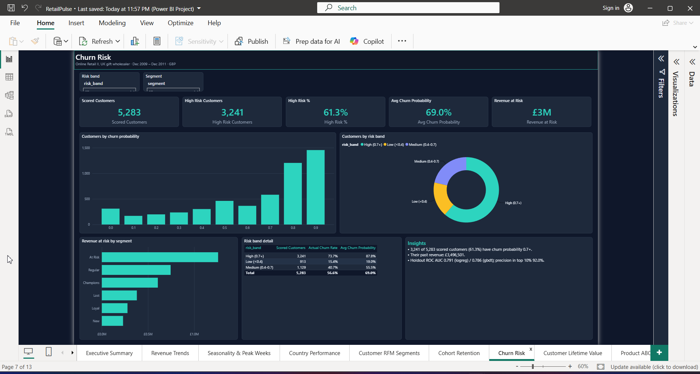
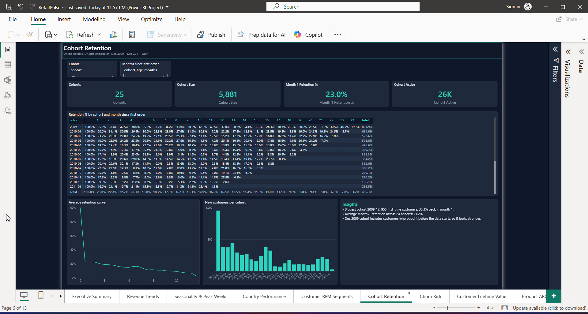
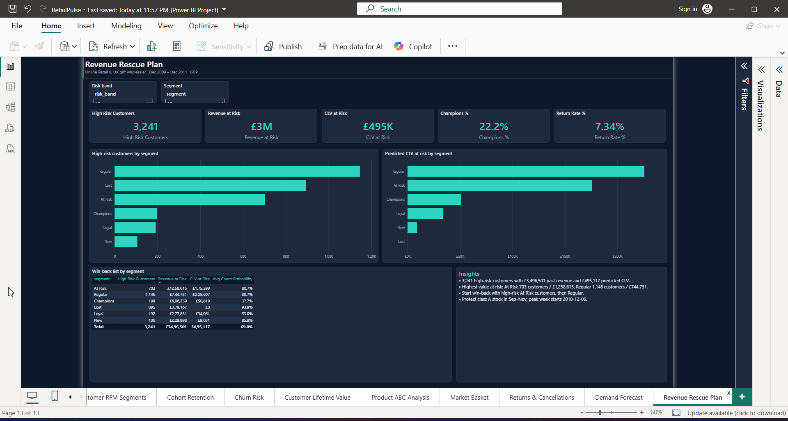

## RetailPulse

Churn, CLV and demand forecasting on the UCI Online Retail II dataset (UK gift wholesaler,
Dec 2009 - Dec 2011). DuckDB warehouse, scikit-learn / lifetimes models tracked in mlflow, a small
ask-your-data API (question -> SQL) and a Power BI dashboard.

### Setup

- Create a venv (Python 3.13):

```bash
C:\Users\nishant\anaconda3\python.exe -m venv .venv
.\.venv\Scripts\python -m pip install -U pip
.\.venv\Scripts\python -m pip install -e ".[dev]"
```

### M1: Run ETL (download -> clean -> quality)

```bash
.\.venv\Scripts\python -m retailpulse.etl run
```

Outputs:
- `data/raw/online+retail+ii.zip` and the extracted `.xlsx`
- `data/clean/transactions.parquet`

### M2: Build warehouse + marts + Power BI exports

```bash
.\.venv\Scripts\python -m retailpulse.warehouse build
```

Outputs:
- `warehouse/retailpulse.duckdb`
- `data/powerbi/*.parquet` (exported tables)

### M3: Train + score models (mlflow + Power BI outputs)

```bash
.\.venv\Scripts\python -m retailpulse.models run
```

Outputs:
- `mlruns.db` (mlflow sqlite tracking db)
- `reports/metrics.json`
- `data/powerbi/churn_scores.parquet`, `clv_scores.parquet`, `forecast.parquet`, `rfm_segments.parquet`

### M4: Ask-your-data API (FastAPI)

```bash
.\.venv\Scripts\python -m retailpulse.ask serve --host 127.0.0.1 --port 8000
```

Optional model endpoint (any OpenAI-compatible API):
- `LLM_BASE_URL`
- `LLM_API_KEY`
- `LLM_MODEL`

If unset, `POST /ask` answers from built-in SQL templates and says so in the response.

### Real model metrics (from `reports/metrics.json`)

```json
{
  "churn": {
    "pr_auc_gbdt": 0.8042768157874725,
    "pr_auc_logreg": 0.8163562892227424,
    "precision_at_top10_gbdt": 0.8901515151515151,
    "precision_at_top10_logreg": 0.9204545454545454,
    "roc_auc_gbdt": 0.7858496227484081,
    "roc_auc_logreg": 0.7911623176685378
  },
  "clv": {
    "mae": 619.7199620253165,
    "rmse": 3849.9463155816625
  },
  "forecast": {
    "mape_baseline": 6.791016200835314,
    "mape_model": 2.4847302910506435,
    "wape_baseline": 0.9959638605887903,
    "wape_model": 0.7148990147810437
  }
}
```

### M5: Power BI dashboard

`dashboard/RetailPulse.pbip` is a Power BI project (PBIR report + TMDL model) with 13 pages:
Executive Summary, Revenue Trends, Seasonality & Peak Weeks, Country Performance, Customer RFM Segments,
Cohort Retention, Churn Risk, Customer Lifetime Value, Product ABC Analysis, Market Basket,
Returns & Cancellations, Demand Forecast, Revenue Rescue Plan.

The project files are written by a script, so edit the script and rerun it instead of editing json by hand:

```bash
.\.venv\Scripts\python tools\compute_insights.py   # reports/insights.md
.\.venv\Scripts\python tools\generate_pbip.py      # dashboard/
.\.venv\Scripts\python tools\check_pbip.py         # field / schema checks
```

The model reads `data/powerbi/*.parquet` through the `DataFolder` parameter (set to this repo's
`data\powerbi` when the script runs). Data is not committed; run M1-M3 first, then open the pbip
in Power BI Desktop and click Refresh.

Numbers shown in the report (Dec 2009 - Dec 2011, GBP):

| | |
|---|---|
| Revenue | £20,755,215 |
| Orders | 45,336 |
| Customers | 5,881 |
| AOV | £457.81 |
| Return rate (by revenue) | 7.34% |
| UK share of revenue | 85.1% |
| Champions share of customers / customer revenue | 22.2% / 68.4% |
| Customers with churn probability >= 0.7 | 3,241 of 5,283 (past revenue £3,496,501) |
| Class A products / share of revenue | 976 of 5,299 / 80.0% |
| Forecast WAPE, model vs baseline | 71.5% vs 99.6% |

Walkthrough video: [screenshots/retailpulse-powerbi-walkthrough.mp4](screenshots/retailpulse-powerbi-walkthrough.mp4)






Open dashboard/RetailPulse.pbix in Power BI Desktop (data included), or the .pbip project to see the model as text.

All 13 page screenshots are in `screenshots/powerbi/`.
